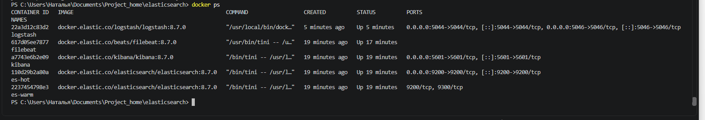
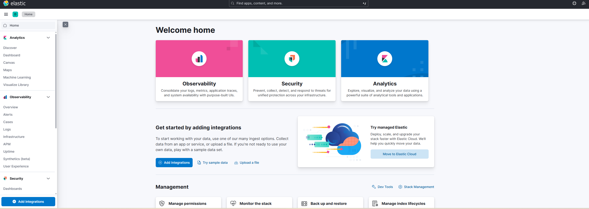
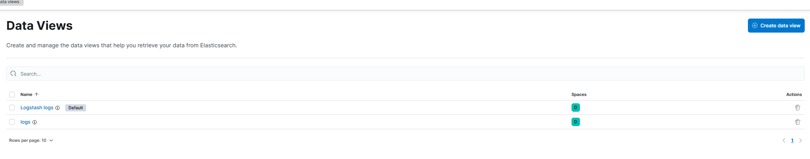
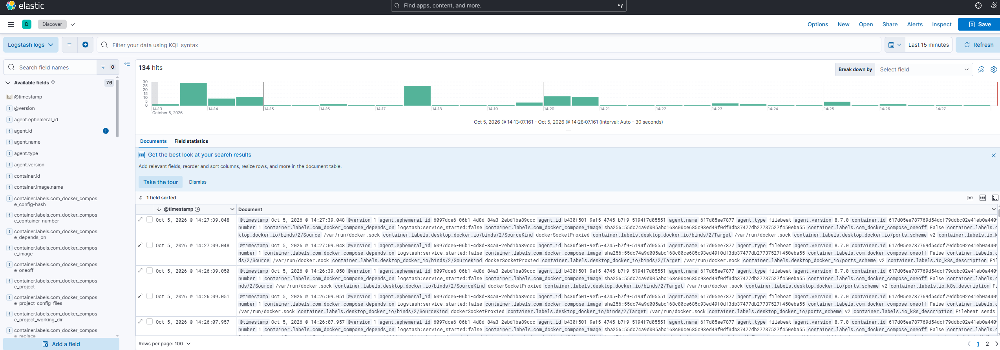
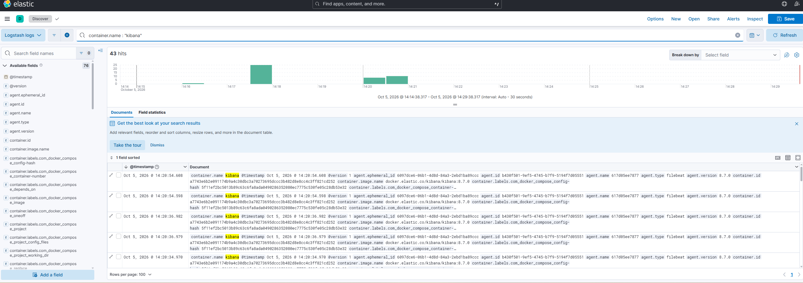

# Домашнее задание «Система сбора логов Elastic Stack»

## Задание 1.

### Подготовка

Для выполнения задания был создан отдельный Docker-стенд с компонентами Elastic Stack.

В рамках работы необходимо запустить и связать между собой:

Elasticsearch — две ноды: hot и warm;

 - Logstash;

 - Kibana;

 - Filebeat.

 ### Elasticsearch

 Для логов и хранения данных мы будем использовать две ноды:

 - hot, для активно используемых данных.
 - warm, для долгосрочного хранения.

### Filebeat

Используется для сборов логов Docker контейнеров.

### Kibana

Для визуализации и анализа данных.

### Запуск.

После docker compose up -d запустили все сервисы.

На скриншоте все контейнеры поднялись.

Веб интерфейс kibana:

## Задание 2.

Как по лекции создаем два Data view index pattern как в лекции:

Используем два шаблона поиска логов.

Первый - все индексы.
Второй - отображает только индексы за октябрь 2026 года.

Смотрим как Кибана отображает все наши логи:

Логи Docker-контейнеров собираются Filebeat, передаются в Logstash и сохраняются в Elasticsearch в индексах logstash-*.
